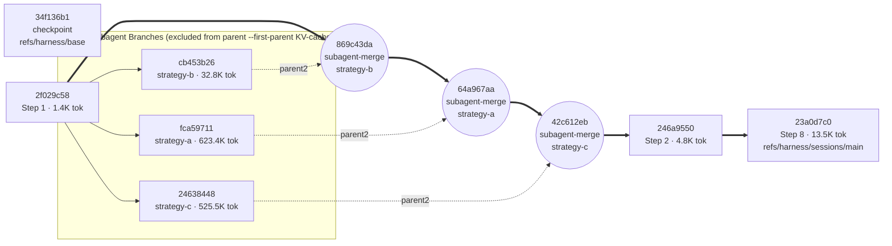
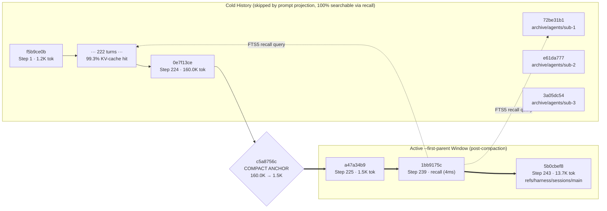
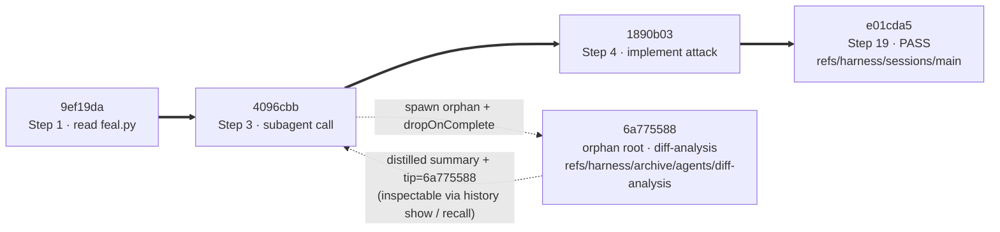
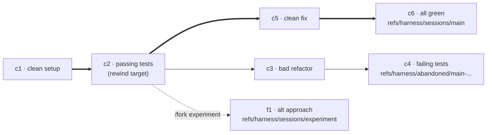

# git-harness

A first-principles coding agent harness where **Git is a first-class resident**—not a bolted-on tool. Zero npm dependencies, running directly on Node.js (`>= 22.18` / `24`).

> **Technical Report:** [*Git as a First-Class Agent Substrate: A Co-Atomic, Prefix-Invariant Harness for Long-Horizon Coding Agents*](./paper/git-harness-paper.pdf) ([LaTeX source & reproducible figures](./paper/))

## Core Thesis

Modern coding agent harnesses repeatedly reinvent partial versions of Git across disconnected subsystems:

- **Tree-structured session logs** → a custom commit DAG
- **Pre-edit file checkpoints & rewind** → custom tree snapshots
- **Compaction & cold recall** → append-only history + projected views
- **Subagent worktrees** → isolated code branches disconnected from conversation state
- **Versioned skills & persistent memory** → unversioned markdown folders

`git-harness` unifies all of these onto Git's native content-addressed object model (blobs, trees, commits, shadow refs, worktrees, and notes) while keeping the user's normal branches and `git status` completely clean.

---

## Performance & Benchmarks

### 1. Terminal-Bench v2.1 (89 Tasks — Clean Full Sweeps: `git-harness` vs. `pi v0.83.0`)

Evaluated on the full `terminal-bench/terminal-bench-2-1` suite (**89 tasks**, `k = 1`) using an identical OpenAI-compatible reasoning model endpoint (`reasoning_effort = high`, `max_tokens = 32768`) and Harbor sandbox runner. Full breakdown in [BENCHMARK_TB21.md](./BENCHMARK_TB21.md).

| Metric | `pi v0.83.0` | `git-harness v0.5` | `git-harness v0.7.1` (Clean Full Sweep) |
| :--- | :---: | :---: | :---: |
| **Tasks Passed (Full-Sweep Pass@1)** | `76 / 89` (`85.39%`) | `70 / 89` (`78.65%`) | **`72 / 89` (`80.90%`)** *(McNemar `p = 0.455`)* |
| **Weighted Live KV-Cache Hit Rate** | `93.77%` | `97.35%` | **`97.40%` (`+3.63%` vs `pi`)** |
| **Git Checkpoint Overhead (Med / Mean)** | — | `0.206%` / `1.162%` | **`0.176%` / `0.585%`** |
| **Portable `session.bundle` Survival** | — | `84 / 89` (`73.4 KB` med) | **`89 / 89` (`100%`, `62.9 KB` med)** |

*(Targeted failure re-runs during `v0.6 → v0.7.1` development reached a multi-run union of `81/89 = 91.01%`; the clean unconditioned `v0.7.1` full sweep above avoids selection bias and shows statistical parity with `pi v0.83.0` while delivering higher KV-cache hit rate and 100% portable Git forensic bundles.)*

**Standout Real-World Telemetry Highlights:**
- **KV-Cache Stability:** `97.40%` weighted live KV-cache hit rate across all 89 tasks (`+3.63%` over `pi v0.83.0`), peaking at `99.3%` on a 243-step run (`path-tracing-reverse`) where dual-parent auto-compaction dropped active context from **`160.0K → 1.5K` tokens** while cold `recall` retrieved archived facts in `2–4 ms`.
- **Negligible Git Overhead & 100% Bundle Survival:** `0.176%` median Git checkpoint overhead (`0.585%` mean, `62.9 KB` median bundle), with **`89/89` (`100%`)** of runs preserving valid `session.bundle` artifacts even on hard timeouts. Detached VM-disk excludes shrank `qemu-alpine-ssh` from **`968 MB → 12.0 KB`** (`21.99% → 0.05%` Git overhead; passed while `pi` failed).
- **Forensic Fix Gains in Clean Full Sweep:** `chess-best-move` passed in **`39.4s`** (`4.2×` faster than `pi`'s `166s`), `crack-7z-hash` passed in **`345.5s`** (`pi` timed out at `1800s`), `feal-differential-cryptanalysis` passed in **`216.6s`** (`6.6×` faster than `v0.5`'s `1440s`), and `gpt2-codegolf` & `merge-diff-arc-agi-task` both flipped `FAIL → PASS`.

### 2. Controlled P1 Ablation Scorecard (`npm run eval`)

| ID | Metric | `git-harness` | Baseline | Target | Status |
| :--- | :--- | :---: | :---: | :---: | :---: |
| `P1-POLLUTION` | Active Context Reduction | **`76.5%` smaller** (`1,054` chars) | `0.0%` (`4,489` chars) | `>= 40%` | PASS |
| `P1-KVCACHE` | KV-Cache Prefix Hit Rate (25 turns + compaction) | **`91.0%`** | `47.5%` (sliding window) | `>= 90%` | PASS |
| `P1-RECALL` | Cold Recall Precision (after 3 compactions) | **`100%` (`10/10`)** | `10%` (`1/10` active-only) | `>= 90%` | PASS |
| `P1-HANDOFF` | Subagent Handoff Compression Ratio | **`3.0%`** (`156/5,250` chars) | `100.0%` (raw inline) | `< 10%` + lossless `parent2` | PASS |

### 3. Git Plumbing Latency Benchmark (`npm run bench`)

Measured on a live Git repository with **10,000 tracked files + 500 ignored files** over 20 turns:

| Operation | p50 | p95 | Max |
| :--- | :---: | :---: | :---: |
| `commitTurn` (incl. `snapshotWorkspace` via shadow index) | **`46.0 ms`** | `64.6 ms` | `66.2 ms` |
| `project(HEAD)` warm (first-parent prompt projection) | **`0.1 ms`** | `0.3 ms` | `0.4 ms` |
| `project(HEAD)` cold (41 messages) | **`15.8 ms`** | — | — |

---

## Visualized Session DAG Examples

Every session, subagent, compaction, and rewind is stored as real Git commits under `refs/harness/*`. Because `SessionStore.project()` walks only `git rev-list --first-parent` back to the latest `compact` anchor, **side-branch exploration and archived history never pollute the active prompt or bust KV-cache**.

### Example 1: Parallel Subagent Branches + Dual-Parent Squash Merges
*Real Terminal-Bench v2.1 trace (`winning-avg-corewars` — solved in **8 steps** vs. `pi`'s 33; `0.03%` Git overhead).*

On Step 2, the parent spawned **3 concurrent subagents** (`strategy-a`, `strategy-b`, `strategy-c`) in isolated worktrees. Together they explored **`1.18M` worker tokens**, then serialized squash-merges onto `main` with `parent2` provenance links—keeping the parent prompt under `13.5K` tokens:



*(Thick arrows `==>` = `--first-parent` hot prompt spine; dashed arrows `-.->` = `parent2` cold provenance preserved in Git & `recall`.)*

### Example 2: Dual-Parent Auto-Compaction + Cold SQLite FTS5 Recall
*Real Terminal-Bench v2.1 trace (`path-tracing-reverse` — **243 steps**, **`99.3%`** live KV-cache hit rate, `0.57%` Git overhead).*

At Step 224 (`0e7f13ce`), prompt context reached `160.0K` tokens. Layer 1 committed a `compact` anchor (`c5a8756c`), dropping Step 225 (`a47a34b9`) to **`1.5K` tokens** without deleting a single prior commit. On Steps 239 and 241, the agent queried `recall` to pull exact details back from pre-compaction history in `2–4 ms`:



### Example 3: Orphan Research Subagent + Archive Observability (`v0.7`)
*Real Terminal-Bench v2.1 trace (`feal-differential-cryptanalysis` — `1440s → 185.1s`, **`7.8×` faster** in `v0.7`; `39.8 KB` bundle).*

When a parent delegates read-only research with `contextMode: "orphan"` and `dropOnComplete: true`, the worker starts from a clean root (`parents: []`), runs graceful synthesis if it hits `maxSteps`, archives at `refs/harness/archive/agents/<id>`, and remains immediately inspectable via `history show` and auto-refreshed `recall`:



### Example 4: Co-Atomic Rewind + Session Forking
When an agent hits a dead end, `history({ action: "rewind", targetSha })` (or `/rewind <sha>`) atomically restores **both** conversation state and workspace files to a clean checkpoint while preserving the abandoned branch under `refs/harness/abandoned/*`:



---

## Usage

Requires **Node.js >= 22.18** (Node 24 recommended) and `git`. Zero `npm install` step required.

### 1. Run Tests, Ablations & Latency Benchmark

```bash
# Full unit + E2E test suite (43 tests)
npm test

# P1 controlled ablation scorecard
npm run eval

# 10,000-file Git shadow-index latency benchmark
npm run bench
```

### 2. Interactive Coding Session (REPL)

Set an API key (`OPENAI_API_KEY`, `ANTHROPIC_API_KEY`, or `DEEPSEEK_API_KEY`) or configure [models.json](./models.json):

```bash
export OPENAI_API_KEY="sk-..."
node src/cli/main.ts --provider openai --model gpt-4.1 --session main

# Or Anthropic
export ANTHROPIC_API_KEY="sk-ant-..."
node src/cli/main.ts --provider anthropic --model claude-sonnet-4-5 --session main

# Or any OpenAI-compatible local server (vLLM / SGLang / Ollama)
node src/cli/main.ts --base-url http://127.0.0.1:8000/v1 --model my-model --session main
```

**Interactive REPL commands:**
- `/log`, `/tree` — Show first-parent session history
- `/sessions` — List all harness sessions (`refs/harness/sessions/*`)
- `/fork <name>` / `/switch <name>` — Branch and switch sessions without touching workspace branches
- `/rewind <sha-prefix>` — Co-atomically rewind both conversation and workspace files (preserving abandoned attempt under `refs/harness/abandoned/*`)
- `/compact [focus]` — Create a non-destructive dual-parent compaction anchor
- `/memory [path]` / `/skills [name]` / `/recall <query>` — Inspect persistent memory, versioned skills, or search cold history via SQLite FTS5

### 3. Headless Autonomous Run (CI, Scripts & Profiling)

```bash
node src/cli/main.ts \
  --repo /path/to/project \
  --provider openai \
  --model gpt-4.1 \
  --session main \
  --max-steps 120 \
  --checkpoint-every 1 \
  --auto-compact-tokens 160000 \
  --offload-bytes 8192 \
  --time-budget-sec 900 \
  --profile /tmp/profile.jsonl \
  --bundle-out /tmp/session.bundle \
  run -- "Fix the failing unit tests and summarize the root cause"
```

- **Non-Git workspaces:** Pass `--git-dir /tmp/harness.git` to store all harness commits in a detached Git directory with zero `.git` directory inside the target workspace.
- **Forensic inspection:** Any exported `session.bundle` is a standard Git bundle—unpack with `git clone /tmp/session.bundle` or inspect with `git bundle list-heads /tmp/session.bundle`.

### 4. Safety, Sandboxing & MCP Extensions

```bash
# Require interactive approval before mutating tools (write/edit/bash/subagent/rewind)
node src/cli/main.ts --approve --session main

# Restrict bash writes to workspaceRoot via OS kernel sandbox (macOS sandbox-exec / Linux bwrap)
node src/cli/main.ts --sandbox --session main          # network allowed
node src/cli/main.ts --sandbox-no-net --session main   # network disabled

# Attach one or more stdio MCP servers
node src/cli/main.ts --mcp "node path/to/mcp-server.mjs" --session main
```

### 5. Offline Git Inspection & JSON-RPC 2.0 Mode (No API Key Required)

```bash
node src/cli/main.ts sessions
node src/cli/main.ts log
node src/cli/main.ts fork experiment-a
node src/cli/main.ts rewind <sha-prefix>
node src/cli/main.ts memory list
node src/cli/main.ts memory put system/conventions.md "Prefer minimal diffs."
node src/cli/main.ts skills list
node src/cli/main.ts recall "query terms"
node src/cli/main.ts rpc   # NDJSON JSON-RPC 2.0 server over stdio
```

### 6. Harbor Benchmark Runner

```bash
PYTHONPATH=/path/to/git-harness/harbor harbor run \
  -d terminal-bench/terminal-bench-2-1 \
  --agent git_harness_agent:GitHarnessAgent \
  -m gpt-4.1 \
  --ak provider=openai \
  --ak checkpoint_every=1 \
  --ak offload_bytes=8192 \
  --ak auto_compact_tokens=160000
```

### 7. Programmatic TypeScript API

```ts
import {
  AgentRuntime,
  GitCliStore,
  OpenAICompatAdapter,
  RecallIndex,
  SessionStore,
  createCoreTools,
  createHistoryTool,
  createRecallTool,
  createStuckLoopHook,
  sessionRef,
} from "./src/index.ts";

const store = new GitCliStore({ repoRoot: process.cwd() });
const sessions = new SessionStore(store);
const recall = new RecallIndex({ store, sessions });

const runtime = new AgentRuntime({
  sessions,
  model: new OpenAICompatAdapter({ model: "gpt-4.1", apiKey: process.env.OPENAI_API_KEY! }),
  workspaceRoot: store.repoRoot,
  defaultCheckpointEverySteps: 1,
  offloadOutputThresholdBytes: 8192,
  tools: [...createCoreTools(), createHistoryTool(sessions), createRecallTool(recall)],
  hooks: [createStuckLoopHook({ sessions })],
});

const result = await runtime.runTurn({
  sessionRef: sessionRef("main"),
  userInput: "Run tests and fix any regressions.",
});
console.log(result.commitSha, result.stopReason, result.assistantText);
```

---

## Architecture & Module Layout

- `src/git-store/` — **Layer 0**: pure Git object/ref plumbing, persistent shadow index, detached `--git-dir` with automatic large-file/unborn-repo guards, worktrees, notes, plus `InMemoryObjectStore`.
- `src/session/` — **Layer 1**: turn DAG, co-atomic rewind, dual-parent compaction anchors, KV-cache-preserving `project()`, and `history` tool (`log`, `branches`, `show`, `diff`, `rewind`).
- `src/runtime/` — **Layer 2**: minimal 4-tool loop (`read`, `write`, `edit`, `bash`) with wave-parallel execution, multimodal image `read`, `blob://` & `commit://` reading, graceful `maxSteps` synthesis handoff, `RuntimeHook`s (`StuckLoopHook`, `ApprovalHook`), zero-dep streaming OpenAI/Anthropic/Mock adapters, and Pi-compatible `models.json` loader.
- `src/orchestrator/` — **Layer 3** *(optional)*: Git-native subagent `spawn`/`review`/`integrate` (`squash`, provenance-only merge, `cherry-pick`, `drop`) + `ExternalCliRunner` meta-harness adapter.
- `src/memory/` — **Layer 4** *(optional)*: persistent `refs/harness/memory`, P0-10 anti-poisoning promotion gates, disposable SQLite FTS5 `RecallIndex` (`node:sqlite`) indexing all active/archived/abandoned refs with content-addressed `ensureFresh()`, and pluggable `recall` tool / pinned-memory hook.
- `src/skills/` — **Layer 4** *(optional)*: Git-native versioned skills (`refs/harness/skills` + FS discovery), `skill://<name>/SKILL.md` progressive disclosure, and anti-poisoning promotion gates.
- `src/mcp/` — **Layer 4** *(optional)*: thin zero-dep JSON-RPC 2.0 MCP stdio client (`McpStdioClient`, `loadMcpTools`).
- `src/sandbox/` — **Layer 4** *(optional)*: OS kernel `bash` sandboxing (`sandbox-exec` on macOS, `bwrap` on Linux).
- `src/rpc/` & `src/cli/` — **Layer 5**: thin NDJSON JSON-RPC 2.0 server & streaming interactive/headless CLI.
- `src/eval/` & `harbor/` — P1 ablation suite, step profiler analyzer, and Harbor benchmark runner adapter.

## Documentation

- [DESIGN.md](./DESIGN.md) — First-principles architecture, 6-layer module boundaries, comparative harness study, and Git ref/object schema.
- [RUBRICS.md](./RUBRICS.md) — Evaluation rubrics: simplicity/decoupling gates, P0 automated invariants, P1 benchmark targets, and Git-first litmus tests.
- [BENCHMARK_TB21.md](./BENCHMARK_TB21.md) — Full Terminal-Bench v2.1 benchmark report and forensic `v0.5 → v0.7.1` engineering log.

## License

[MIT](./LICENSE)
